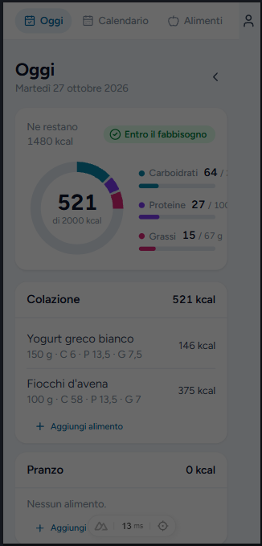

# Segnalazioni

## Ui

- ho cambiato un po' il colore dei testi "muted", 
- la voce "sistema" va un po' da fuori, puoi pure rimpicciolire un po' il font size 
- l'icona utente sul mobile "strett" cambia bg color, in generale vedo che c'è uno spazio a dx penso sia roba di scrollbar , capisci e sistema. Alla peggio usa qualche libreria che gestisce lo scroll (ma mi pare che nuxtui ha già una roba integrata) 
