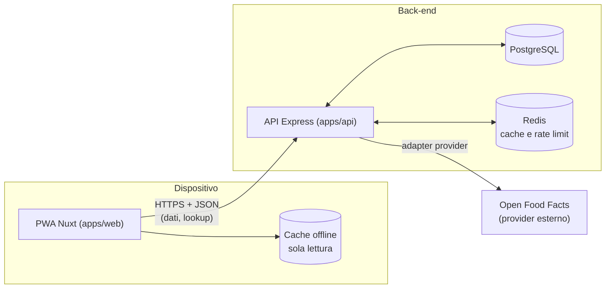

# Architettura

Monorepo pnpm con due applicazioni e un pacchetto condiviso. Le scelte di fondo sono nelle decisioni [server come fonte di verità](./decisione-server-fonte-di-verita.md) e [autenticazione](./decisione-autenticazione.md).

## Componenti

| Componente | Ruolo | Dettagli |
|---|---|---|
| `apps/web` | PWA (SPA statica) installabile, interfaccia in italiano. Legge e scrive tramite l'API; offline mostra i dati in cache | [tecnico/web](../tecnico/web/index.md) |
| `apps/api` | Unico punto di accesso ai dati e ai provider esterni. Moduli per dominio | [tecnico/api](../tecnico/api/index.md) |
| `packages/shared` | Contratti dell'API: schemi zod e tipi | [tecnico/shared](../tecnico/shared/index.md) |
| PostgreSQL | Dati persistenti (alimenti, diario, pasti) | Migrazioni versionate |
| Redis | Cache delle risposte dei provider, rate limit | Prefisso chiavi per ambiente |

## Flussi principali

- **Uso quotidiano**: la PWA legge e scrive tramite l'API, che è l'unica fonte di verità. Offline mostra i dati già scaricati, in sola lettura (vedi [Cache offline](./decisione-cache-offline.md)).
- **Lookup di un prodotto**: la PWA chiede il codice a barre all'API; l'API cerca nel proprio DB, se non c'è interroga il provider tramite il suo adapter, normalizza i dati nel nostro modello, li salva e li restituisce. Il front-end non conosce il provider.
- **Avvio a freddo**: l'API su hosting gratuito si sospende quando è inattiva; il client usa un timeout lungo sulla prima chiamata e mostra uno stato di attesa.

## Ruolo del monorepo

Il monorepo serve soprattutto a **passare i tipi dal back-end al front-end**. Non sono previsti altri layer (né back-office né altri client), quindi `packages/shared` contiene solo i **contratti** dell'API (schemi zod dei DTO e tipi derivati), non logica di dominio. Le regole di business stanno nel back-end; il front-end usa i tipi e, dove serve, gli schemi per validare l'input prima di inviarlo.
